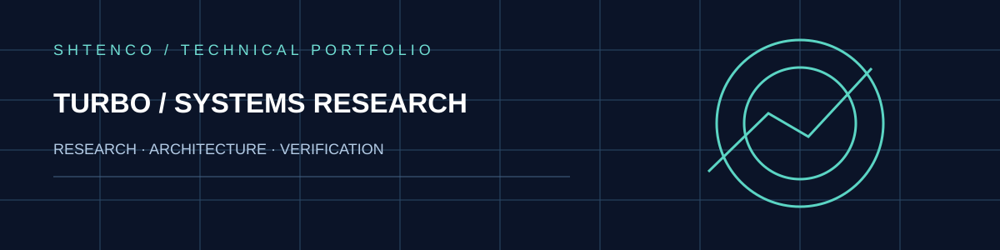
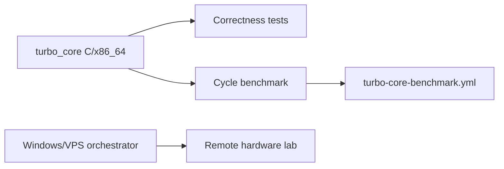

<div align="center">



**Freestanding x86_64 core, low-level benchmarks and legacy Windows-to-VPS orchestration**

[Overview](#engineering-overview) · [Architecture](#architecture-and-data-flow) · [Evidence](#validation-boundaries) · [Original technical dossier](#original-technical-dossier)

</div>

## Engineering overview

Freestanding x86_64 core, low-level benchmarks and legacy Windows-to-VPS orchestration. Principal implementation directories and scripts: `turbo_core/; orchestrator.py; tests/`. The repository includes both implemented research artifacts and separately planned capabilities.

## Architecture and data flow


This is an explanatory diagram, not a claim that every conceptual integration is deployed.

## Validation boundaries

> Repository lists Linux Ubuntu.ppk private key material: rotate/revoke immediately; never promote unverified performance uplift.

Source availability, internal benchmarks and design goals must be distinguished from independently reproduced metrics and production readiness.

## Original technical dossier

---

# TURBO Core development

The active clean-room kernel work now lives in [`turbo_core/`](turbo_core/).
It contains x86_64 fast paths, a capability primitive, bounded IPC, an O(1)
priority scheduler, freestanding compilation checks, correctness tests and a
reproducible cycle benchmark. The legacy Linux/VPS experiment remains below as
historical infrastructure and a future remote hardware-lab runner.

> Performance rule: no uplift claim is accepted unless the exact artifact is
> built, identified, executed, compared against a matched baseline, repeated,
> and published with raw samples and environment metadata.

# Turbo Linux Rebuild (Windows Orchestrator → VPS → KVM)

Проект пересобран с нуля под единый сценарий: **Windows Python оркестратор** подключается к VPS по SSH-ключу, готовит KVM окружение, применяет patch к kernel source и считает прирост производительности относительно baseline Linux профиля (2 GB RAM / 2 vCPU).

## Структура
- `orchestrator.py` — точка запуска.
- `turbo_orchestrator/config.py` — dataclass-конфиг.
- `turbo_orchestrator/ssh_client.py` — SSH + поддержка PuTTY `.ppk`.
- `turbo_orchestrator/workflow.py` — pipeline установки/патча/benchmark.
- `config.example.json` — пример конфигурации.
- `REBUILD_PLAN.md` — план пересборки и внедрения.
- `virtual_qubit_turbo_5.15.patch` — patch, применяемый на VPS.

## Быстрый старт (Windows)
```powershell
python -m venv .venv
.\.venv\Scripts\activate
pip install -r requirements.txt
python orchestrator.py --config config.example.json
```

## Что делает оркестратор
1. Подключается к VPS (`root@92.246.131.14`) по SSH-ключу из репозитория.
2. Ставит пакеты для KVM и сборки ядра.
3. Снимает baseline (`sysbench cpu --threads=2 --time=30`).
4. Копирует patch на VPS и применяет к `linux-source`.
5. Применяет runtime tuning (`sched_autogroup`, `swappiness`).
6. Повторно запускает benchmark и считает `uplift_percent`.
7. Сохраняет JSON-отчет в `results/`.

## Примечания
- Для `.ppk` нужен `puttygen` в PATH.
- Скрипт рассчитан на Ubuntu 24.04 VPS.
- Перед запуском проверьте, что ключи доступа актуальны.


## Windows ошибка `FileNotFoundError: [WinError 2]` на `puttygen`
Если при запуске возникает ошибка, что не найден `puttygen`, значит у вас есть только `.ppk` ключ и не установлен PuTTY Generator.

Решение:
```powershell
winget install PuTTY.PuTTY
# или
choco install putty
```

Проверьте:
```powershell
puttygen --help
```

После этого снова выполните:
```powershell
python orchestrator.py --config config.example.json
```


<!-- SYNERGY-FEDERATION-PASSPORT:START -->
---

## 🧭 SYNERGY federation passport

**Домен:** 🐧 Host OS / runtime substrate  
**Архитектурный родитель:** [`synergy_meta_os`](https://github.com/Shtenco/synergy_meta_os)  
**Архитектурный корень:** [`synergy_system`](https://github.com/Shtenco/synergy_system)


Связь выше показывает место в федерации и **не является доказательством runtime dependency**. Фактические зависимости должны подтверждаться импортами, API-контрактами, manifests, deployment-конфигурацией или тестами.

### Единая шкала доказательности

`GREEN` = воспроизводимо подтверждено · `CANDIDATE` = реализация есть, доказательство неполное · `R&D` = эксперимент · `STUB` = архитектурный узел · `LEGACY` = provenance.

### Навигация

- [📚 Атлас всех 75 репозиториев](https://github.com/Shtenco/synergy_system/blob/main/docs/SYNERGY_REPOSITORY_ATLAS.md)
- [🧾 Машиночитаемый registry](https://github.com/Shtenco/synergy_system/blob/main/registry/SYNERGY_REPOSITORIES.json)
- [🧭 SYNERGY SYSTEM](https://github.com/Shtenco/synergy_system)

### Общее правило утверждений

README не должен утверждать больше, чем подтверждают код, тесты и сохранённые артефакты. Для рыночных/экономических проектов backtest или внутренняя переоценка не равны реализованной внешней прибыли; для AI/infra проектов benchmark или диаграмма не равны production-надежности.

<!-- SYNERGY-FEDERATION-PASSPORT:END -->

---

# 🐧 Глубокий доказательный паспорт TURBO Core

## Две разные линии в одном repo

1. `turbo_core/` — активная clean-room kernel/core линия;
2. старый Windows→VPS→KVM orchestrator — legacy infrastructure/hardware-lab path.



## Security hygiene finding

В repository tree видны файлы `Linux Ubuntu.ppk` / `.pub`. Private SSH key material в Git является критическим риском независимо от того, действует ли ключ сейчас. Такой ключ следует считать скомпрометированным и заменить.

## Performance rule

Uplift принимается только для exact artifact + matched baseline + raw repeated samples + environment metadata.

## Следующий рубеж

rotate/remove committed credentials → CI artifact hashes → freestanding boot/runtime evidence → QEMU/hardware repeatability → Meta-OS host capability contract.
